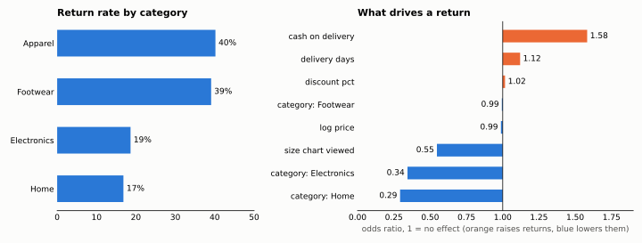

# E-commerce return analysis

I presented a paper on reducing product returns at the Alliance University International Conference. The original was done in R and Python on transaction data I can't share, so this is a Python version on 8,000 synthetic orders that follows the same approach.

The question was simple: what about an order makes it more likely to come back?



## Approach

First a plain look at return rate by category. Then a logistic regression on category, discount, delivery days, payment mode, price, and whether the buyer opened the size chart.

I report odds ratios rather than raw coefficients. "Cash on delivery orders have about 1.6 times the odds of coming back" is something a category manager can act on. A log-odds number isn't.

## What came out

- Apparel (40%) and footwear (39%) are returned far more often than electronics (19%) and home (17%).
- Cash on delivery has an odds ratio of 1.58, the biggest push towards a return.
- Each extra day of delivery adds about 12% to the odds.
- Buyers who opened the size chart had roughly half the odds of returning (0.55).
- ROC-AUC on the held-out quarter is 0.73. Good enough to explain the drivers. I wouldn't use it to block orders.

For a real store I'd suggest showing the size chart by default on apparel and footwear, nudging cash-on-delivery buyers towards prepaid, and keeping a close eye on delivery times in the high-return categories.

## Running it

```bash
pip install -r requirements.txt
python return_analysis.py
```
